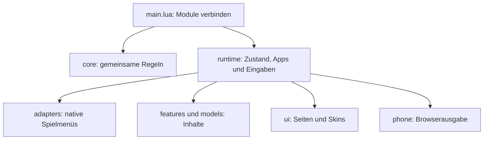

# Am Projekt arbeiten

Kanto Gear bleibt ein Lua-Mod für Recomp. Der Einstieg ist
[`mod/kanto_gear/main.lua`](mod/kanto_gear/main.lua). Er verbindet die Module in
festgelegter Reihenfolge; die Bildschirm- und Spiellogik liegt in den folgenden
Verzeichnissen.

| Verzeichnis | Hier suchen, wenn … |
| --- | --- |
| `core/` | Schrift, Farben, Layoutregeln, Einstellungen, Discovery, Touchschutz oder gemeinsame Menüverträge betroffen sind. |
| `runtime/` | Eine App geöffnet wird, sich der Spielzustand ändert oder Eingabe, Darstellung und Recomp-Hooks zusammenspielen. |
| `adapters/gen1_2/` | Ein natives Menü aus Rot bis Kristall angepasst werden muss. Diese früher `legacy_*` genannten Adapter werden weiterhin benötigt. |
| `adapters/gen3/` | Die Einbindung von Feuerrot, Blattgrün, Rubin, Saphir oder Smaragd betroffen ist. |
| `adapters/` | Gemeinsame native Startmenü-, Karten- und Pokédex-Schnittstellen betroffen sind. |
| `features/` | Notizen, Stamps, PSS, Geschenke oder Beeren ihre Daten und Regeln ändern. |
| `models/` | Pokémon-Informationen, Entwicklung, Habitate oder Zusammenfassungen aufbereitet werden. |
| `ui/pages/` | Eine gemeinsame Bildschirmseite ihre Geometrie oder Interaktionen ändert. |
| `ui/skins/` | Pokégear oder C-Gear anders gezeichnet werden sollen. App-Seiten liegen unter `apps/`, native Begleitansichten unter `native/`. |
| `ui/base/` | Gemeinsame Zeichenhilfen oder ausdrücklich weiterverwendete Basisteile betroffen sind. |
| `ui/fonts/`, `fonts/` | Bitmap-Schriften, Messwerte, TrueType-Fallbacks oder deren Lizenzen betroffen sind. |
| `i18n/` | Eine Übersetzung oder die Auswahl der Sprache geändert wird. |
| `phone/` | Browseranzeige, lokales Pairing, Transport oder Videodecoder betroffen sind. |
| `tests/` | Verhalten ohne laufendes Spiel geprüft werden soll. Die Tests gehören nicht ins Mod-Paket. |

Alle Pfade dieser Tabelle liegen unter `mod/kanto_gear/`. Außerhalb davon enthält
`tools/` die Prüf- und Vorschauwerkzeuge, `translations/` die separat verteilten
Sprachpakete und `screenshots/` die Bilder für die Projektseite.

## Zusammenspiel



Jedes Laufzeitmodul bekommt seine Abhängigkeiten ausdrücklich als Argumente.
Veränderliche Sitzungsdaten gehören in `session`, Grafikzustand in `render`.
Insbesondere darf ein Modul eine später ersetzte Zeichenfläche nicht als lokale
Kopie behalten. Dauerhafte Notizen, Einstellungen und Home-Layouts verwenden
weiterhin ihre bestehenden Speicherpfade und Formate.

Die vollständige Geräte-UI wird über `ui/init.lua` aufgebaut. `ui/base/init.lua`
ist eine interne Grundlage und wird anschließend durch die aktuellen Skins
ergänzt. Neue Vorschauwerkzeuge verwenden den vollständigen Einstieg.

Die Gen-3-Adapter haben drei kleine Einstiege: `adapters/gen3/init.lua` verbindet
die Datenmodelle unter `models/`, `ui.lua` die Menüprojektionen unter `ui/` und
`progress.lua` die Zielauswertung unter `progress/`. Sie erhalten einen
`read(path)`-Callback und liefern ihre Klasse zurück. Zur Laufzeit stammt der
Reader aus `mod:read`; dadurch funktionieren die Unterdateien auch im gepackten
Mod. Tests verwenden dafür `tests/support/module.lua`.

In `adapters/gen3/ui/menus/` liegen die fachlichen Menü-Builder für Items,
Lagerung, Shops, Systemmenüs, Attacken und Party. Sie füllen eine gemeinsame
`projection`; `ui/menus.lua` hält Cursorbindung, Gültigkeitsprüfung und Layout
zusammen. Inventar-, Geld- und Pokémon-Änderungen führt weiterhin der native
Handler aus. Neue Menüs müssen insbesondere veraltete Projektionen und Eingaben
während nativer Animationen abweisen.

`adapters/gen3/progress/` trennt Skriptbeweise, Pokémon-Belohnungen, Katalog und
aktuellen Erledigungszustand. Editionsregeln, die nicht aus einem Hide-Flag
folgen, stehen in `policies.lua`, etwa die verschiedenen Fossilentscheidungen.
Eine neue Ausnahme gehört mit einem positiven und negativen Fall in
`tests/gen3_policy_test.lua`; ein verstecktes Objekt allein beweist keinen Erhalt.

Spielunterschiede tragen am zuständigen Block `Game path [Spiele]: Grund`.
`Host path` kennzeichnet API-/Datenkompatibilität, `Mod path` die Anbindung einer
anderen Mod. Den Geltungsbereich historischer Namen und die vollständige Liste
der gekennzeichneten Dateien erklärt der
[Überblick über Spiel- und Kompatibilitätspfade](maintenance/game-specific-paths.md).

Für eine Änderung an einer App zuerst die passende Datei unter `runtime/`
aufsuchen, dann ihr Datenmodell und ihre Bildschirmseite. Der App-Katalog und
die anfängliche Verdrahtung stehen in `runtime/bootstrap.lua`; Hooks in
`runtime/hooks.lua`. Große Sprachkataloge und `ui/skins/icon_art.lua` enthalten
überwiegend Daten. Die QR-Bibliothek unter `vendor/` ist Fremdcode mit eigener
Lizenz.

## Prüfen

Python 3 und LuaJIT werden benötigt. Für native Integrationstests außerdem einen
passenden Recomp-SDK-Checkout und die lokal erzeugten Spieldaten verwenden.
Die Dateien werden nicht mit diesem Repository verteilt.

1. `tools/test-config.example.json` nach `tools/test.local.json` kopieren.
2. SDK-, Cache- und gegebenenfalls Chromium-Pfade eintragen. Die lokale Datei
   wird von Git ignoriert.
3. Aus dem Projektverzeichnis prüfen:

```powershell
python tools/check.py
python tools/test.py --config tools/test.local.json
python tools/test.py --config tools/test.local.json --only home_runtime_test --edition crystal
python tools/test.py --config tools/test.local.json --browser
```

Der letzte Aufruf ergänzt einen unsichtbaren Browser-Test für Pairing,
Controller, Layouteditor und Videodecoder. Er öffnet kein Spiel. Ergebnisse und
Einzellogs liegen unter `diagnostics/`. Fehlgeschlagene Fälle führen zu einem
Fehlerstatus; sie werden nicht als bestanden umgedeutet. Den bekannten Stand
und die Grenzen der bisherigen Absicherung beschreibt der
[Vorher-nachher-Vergleich](maintenance/refactoring-4.0.5.md).

Die Vorschauwerkzeuge unter `tools/*_preview/` rendern mit LÖVE. Das Hauptwerkzeug
`tools/hgss_preview/` bietet Gen-1/2-, Light/Dark- und Skin-Varianten. Synthetische
Bildfixtures ersetzen dabei teilweise echte Pokémon-Portraits. Die Vorschauen
prüfen Geometrie und Darstellung; echte Geräte- und Spielstände benötigen einen
zusätzlichen manuellen Durchgang.

## Paket bauen

Vor einem Build alle Worktrees der beteiligten Repositories auf Änderungen
prüfen und festlegen, welcher Commit sämtliche vorgesehenen Funktionen enthält.
Ein anderer offener Worktree wird nicht automatisch Teil dieses Pakets.

Wenn Testdateien hinzugekommen sind:

```powershell
python tools/package.py --sync-ignore
```

Danach die vollständige Änderung prüfen und committen. Anschließend:

```powershell
python tools/package.py
```

Das Werkzeug liest die Mod-Dateien direkt aus `HEAD`, verweigert uncommittete
Mod-Änderungen und kontrolliert das erzeugte ZIP einschließlich aller Bytes,
Feature-Dateien, Manifestdaten und Lizenzen. `dist/` enthält das Paket und einen
Prüfbericht mit Quellcommit und SHA-256-Werten. Die Versionsnummer und der Paketname
`kanto_gear-<version>.zip` folgen dem committed Manifest. Es entsteht kein APK; eine native
Engine und ein APK-Signer sind deshalb nicht Bestandteil des ZIP-Prüfberichts.

Modkit unterstützt in `.modkitignore` nur exakte Dateipfade. Die Liste wird
deshalb erzeugt und nicht durch ein wirkungsloses `tests/`-Muster ersetzt.
