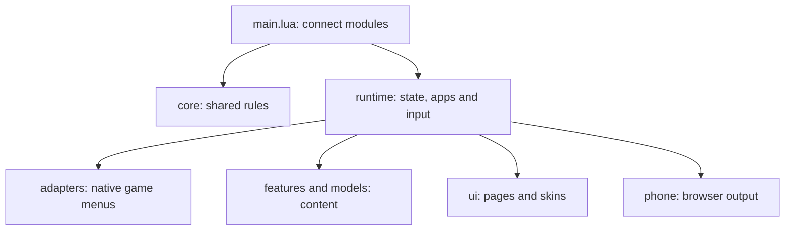

# Working on Kanto Gear

Kanto Gear is a Lua mod for Recomp. Its entry point is
[`mod/kanto_gear/main.lua`](mod/kanto_gear/main.lua). It connects the modules in
a defined order; screen and game logic live in the directories below.

| Directory | Look here when changing… |
| --- | --- |
| `core/` | Fonts, colors, layout rules, settings, Discovery, touch guards or shared menu contracts. |
| `runtime/` | App navigation, game-state updates, input, rendering and Recomp hooks. |
| `adapters/gen1_2/` | Native menus from Red through Crystal. These adapters, previously named `legacy_*`, remain necessary. |
| `adapters/gen3/` | Integration with FireRed, LeafGreen, Ruby, Sapphire or Emerald. |
| `adapters/` | Shared native start-menu, map and Pokédex interfaces. |
| `features/` | Notes, Stamps, PSS, gifts, berries and their rules. |
| `models/` | Pokémon information, evolutions, habitats and summaries. |
| `ui/pages/` | Shared screen geometry and interactions. |
| `ui/skins/` | Pokégear or C-Gear drawing. App screens live under `apps/`; native companion views under `native/`. |
| `ui/base/` | Shared drawing helpers and base methods that are still used. |
| `ui/fonts/`, `fonts/` | Bitmap fonts, metrics, TrueType fallbacks and their licenses. |
| `i18n/` | Translations and language selection. |
| `phone/` | Browser display, local pairing, transport and video decoding. |
| `tests/` | Behavior checks without a running game. Tests are excluded from the mod package. |

All paths in this table are relative to `mod/kanto_gear/`. Outside that directory,
`tools/` contains verification and preview tools, `translations/` contains the
separately distributed language packs, and `screenshots/` holds project-page images.

## How the modules fit together



Each runtime module receives its dependencies explicitly as arguments.
Mutable session data belongs in `session`; graphics state belongs in `render`.
In particular, a module must not retain a local copy of a canvas that can later
be replaced. Persistent notes, settings and Home layouts keep their existing
storage paths and formats.

The complete device UI is built through `ui/init.lua`. `ui/base/init.lua` is an
internal foundation extended by the current skins. New preview tools should
use the complete entry point.

The Gen 3 adapters have three small entry points: `adapters/gen3/init.lua`
connects the data models under `models/`, `ui.lua` connects menu projections
under `ui/`, and `progress.lua` connects objective evaluation under `progress/`.
They accept a `read(path)` callback and return their class. At runtime, the
reader uses `mod:read`, so submodules also work inside the packaged mod.
Tests use `tests/support/module.lua`.

`adapters/gen3/ui/menus/` contains menu builders for items, storage, shops,
system menus, moves and party selection. They populate a shared `projection`;
`ui/menus.lua` keeps cursor binding, validity checks and layout together.
Native handlers still perform inventory, money and Pokémon changes.
New menus must reject stale projections and input during native animations.

`adapters/gen3/progress/` separates script evidence, Pokémon rewards, the
catalog and live completion state. Edition rules that cannot be inferred from
a hide flag belong in `policies.lua`, such as the different fossil choices.
Each new exception needs positive and negative coverage in
`tests/gen3_policy_test.lua`; a hidden object alone does not prove receipt.

Game differences are labeled at the relevant block with `Game path [games]: reason`.
`Host path` marks API/data compatibility; `Mod path` marks integration with
another mod. The [game and compatibility path guide](maintenance/game-specific-paths.md)
explains historical names and lists every annotated file.

For an app change, start with its file under `runtime/`, then follow its data
model and screen. The app catalog and initial wiring are in
`runtime/bootstrap.lua`; hooks are in `runtime/hooks.lua`. Large language
catalogs and `ui/skins/icon_art.lua` mostly contain data. The QR library under
`vendor/` is third-party code with its own license.

## Verification

Python 3 and LuaJIT are required. Native integration tests also need a matching
Recomp SDK checkout and locally generated game data. Those files are not
distributed with this repository.

1. Copy `tools/test-config.example.json` to `tools/test.local.json`.
2. Fill in the SDK, cache and optional Chromium paths. The local file is Git-ignored.
3. Run from the project directory:

```powershell
python tools/check.py
python tools/test.py --config tools/test.local.json
python tools/test.py --config tools/test.local.json --only home_runtime_test --edition crystal
python tools/test.py --config tools/test.local.json --browser
```

The last command adds a headless browser test for pairing, controls, the layout
editor and video decoder. It does not open a game. Results and individual logs
are written under `diagnostics/`. Failed cases return a failure status;
they are never counted as passes. The [before/after comparison](maintenance/refactoring-4.0.5.md)
records the verified scope and its limits.

The tools under `tools/*_preview/` render with LÖVE. The main tool,
`tools/hgss_preview/`, offers Gen 1/2, Light/Dark and skin variants.
Some image fixtures use synthetic Pokémon portraits. Previews check geometry
and rendering; real devices and saves still need a separate manual pass.

## Building a package

Before a build, inspect every worktree of the repositories involved for changes
and identify the commit containing all intended features. Another open
worktree does not automatically become part of the package.

If test files have been added:

```powershell
python tools/package.py --sync-ignore
```

Review and commit the complete change, then run:

```powershell
python tools/package.py
```

The tool reads mod files directly from `HEAD`, rejects uncommitted mod changes
and verifies the generated ZIP, including every byte, feature file, manifest
field and license. `dist/` contains the package and a verification report with
the source commit and SHA-256 hashes. The version and filename
`kanto_gear-<version>.zip` follow the committed manifest. This produces no APK,
so the report contains no embedded native engine or APK signer.

Modkit supports only exact file paths in `.modkitignore`. The list is generated
instead of using an ineffective `tests/` directory pattern.
