

# Kanto Gear

### Silph Link OS — Your adventure. Reconnected.

A DS-inspired companion for Pokémon **Red, Blue, Yellow, Gold, Silver, Crystal,
Ruby, Sapphire, FireRed, LeafGreen and Emerald** in
[Gen1Recomp](https://github.com/bryanthaboi/gen1recomp).

  
  
  

  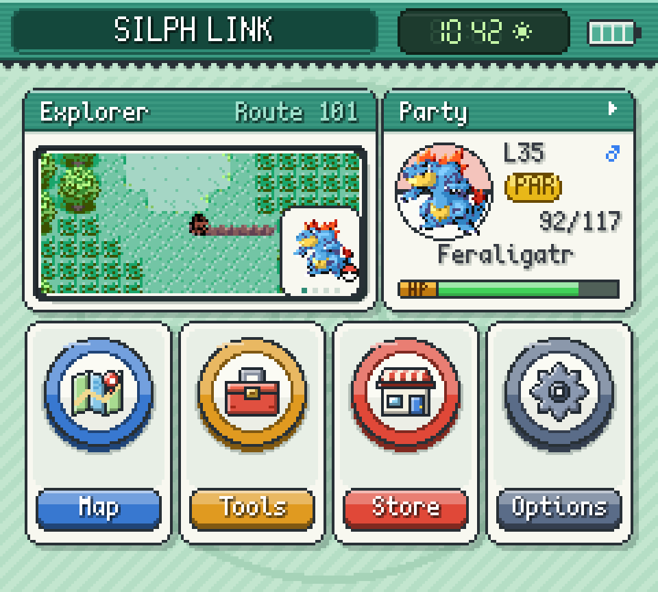
  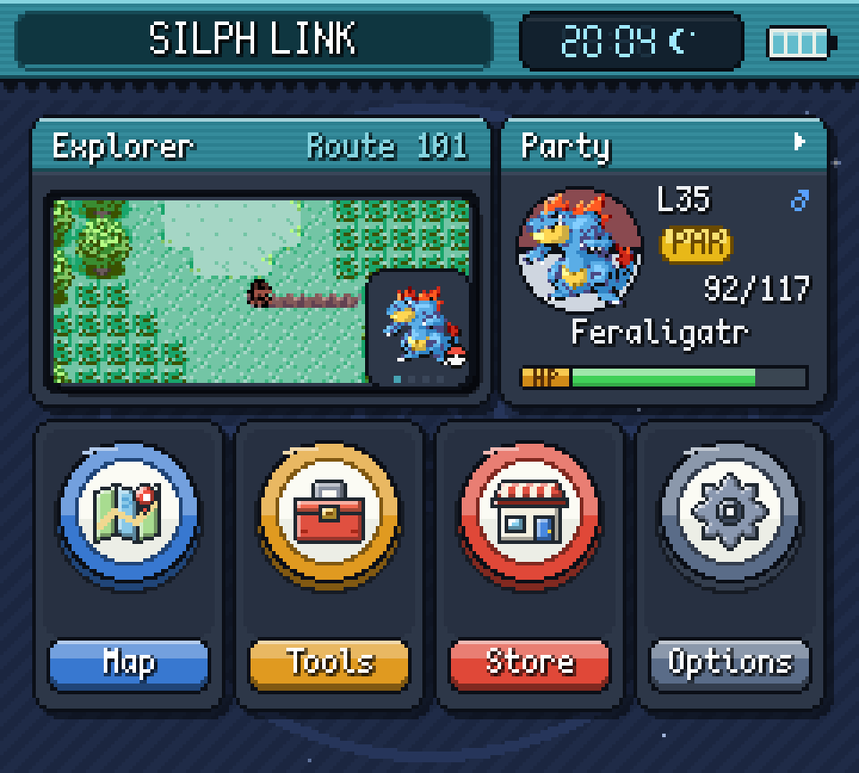
  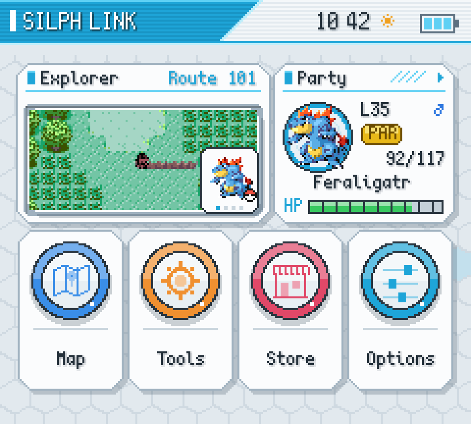
  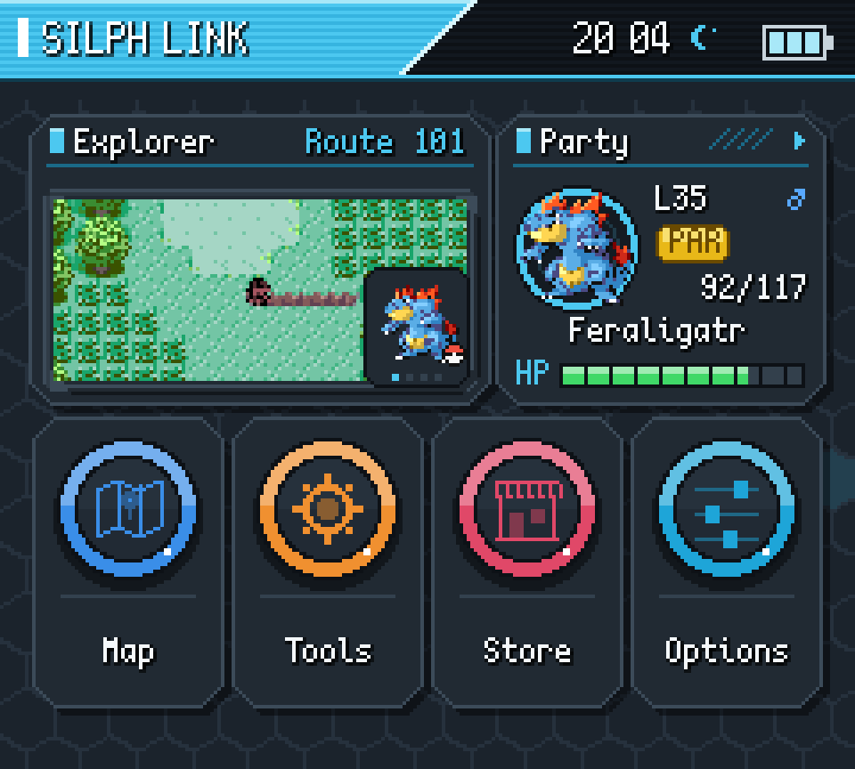

**[Install from Mod Index](https://bryanthaboi.github.io/gen1recomp-mod-index/)
· [Download ZIP](https://github.com/AverageConsumer/kanto-gear/releases/latest)
· [Report a problem](https://github.com/AverageConsumer/kanto-gear/issues)**

## Your companion in Kanto, Johto and Hoenn

Keep the adventure on the game screen and your maps, team, notes and progress
close at hand. Use Kanto Gear on a dual-screen handheld, a phone or your desktop,
with touch or a mouse.

Choose **Pokégear** or **C-Gear**, each with Light, Dark and Auto variants.
Arrange your own Home pages with apps and widgets: long-press to edit, then
add, move or remove tiles. Silph Store lets you enable the optional apps you want.
The clock can follow the game or your device.

## Apps and tools

| App | What it does |
| --- | --- |
| **Explorer** | A detailed local map with three zoom levels, encounters, trainers, items and hidden finds. “Here” prioritizes catches you can make now; “All” helps plan the rest of the location. Trainer positions stay still for inspection while your player and camera keep moving. |
| **Map** | Browse the region, inspect places and select an available Fly destination with a movable cursor and a separate confirmation button. |
| **Party** | Check HP, status, experience, types, held items and moves. Inspect full partner summaries and give or take held items where the game supports them. |
| **Bag** | Browse pockets, inspect items and use the actions available in the current context, including Use, Give and Toss. A recent-item shortcut stays available while you still own that item. |
| **Pokédex** | Search your research, read complete entries, check evolution targets and conditions, and find habitats with encounter methods and access requirements. Native cry, size and form pages are adapted where supported. |
| **Stamps** | Track each location's trainers, items, hidden finds and Pokémon. Open remaining goals to see their location; indoor finds point to the building entrance first, with an option to look inside. |
| **Notes** | Keep general or location-linked text notes, checklists and colored drawings. QWERTY and QWERTZ are available. |
| **Day-Care** | Check boarded Pokémon, current levels, withdrawal fees and moves at pickup. In Gen 2 and 3, also check breeding compatibility, waiting eggs and party eggs. FireRed/LeafGreen keep the Route 5 boarder separate from the Four Island pair. |
| **Calendar** | In Gen 2, browse weekly visitors, time windows, ready rematches and gifts. Hoenn shows the current game day with a 24-hour clock, tides, upcoming berry harvests and ready activities. FireRed/LeafGreen show VS Seeker charge and ready trainers. Timing follows the game's clock. |
| **Field Kit** | Contextual shortcuts for tools and field moves, including rods, Bicycle, Item Radar and travel. Currently usable actions appear first. |
| **Trainer Card** | Your trainer details, regional badges, play time and native records, including the game's card rank where available. |
| **Step Counter** | Track movement, milestones and a resettable session counter. |
| **Silph Connect** | See online players and their reported edition, location and status through Recomp's shared connection. The connection stays active when you leave the app. |
| **Silph Store** | Manage your installed Gear apps and discover what to add to Home. |

Home widgets cover the live Explorer map, lead partner, whole team, Pokédex,
region map, Bag, Trainer Card, steps, Stamps, Silph Connect, Day-Care, Calendar
and individual field tools. The Calendar is available in Gen 2 and 3; the egg
widget is available in games that support breeding. Egg contents, progress,
breeding odds and event schedules follow your information settings.

  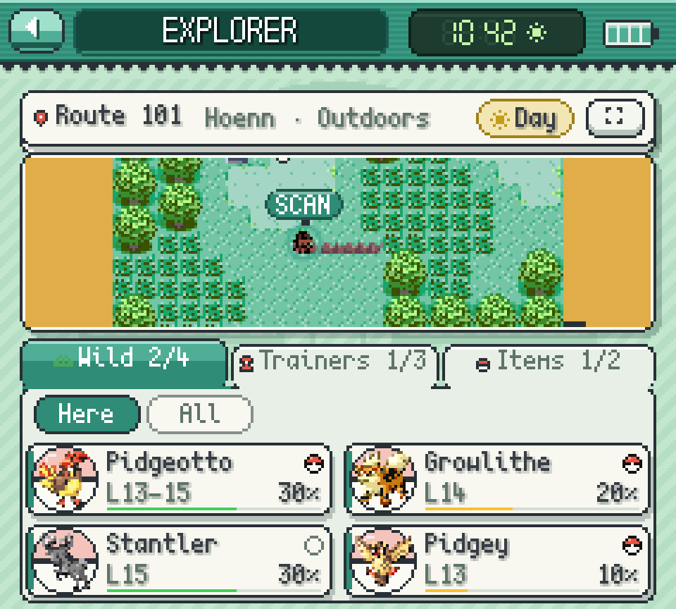
  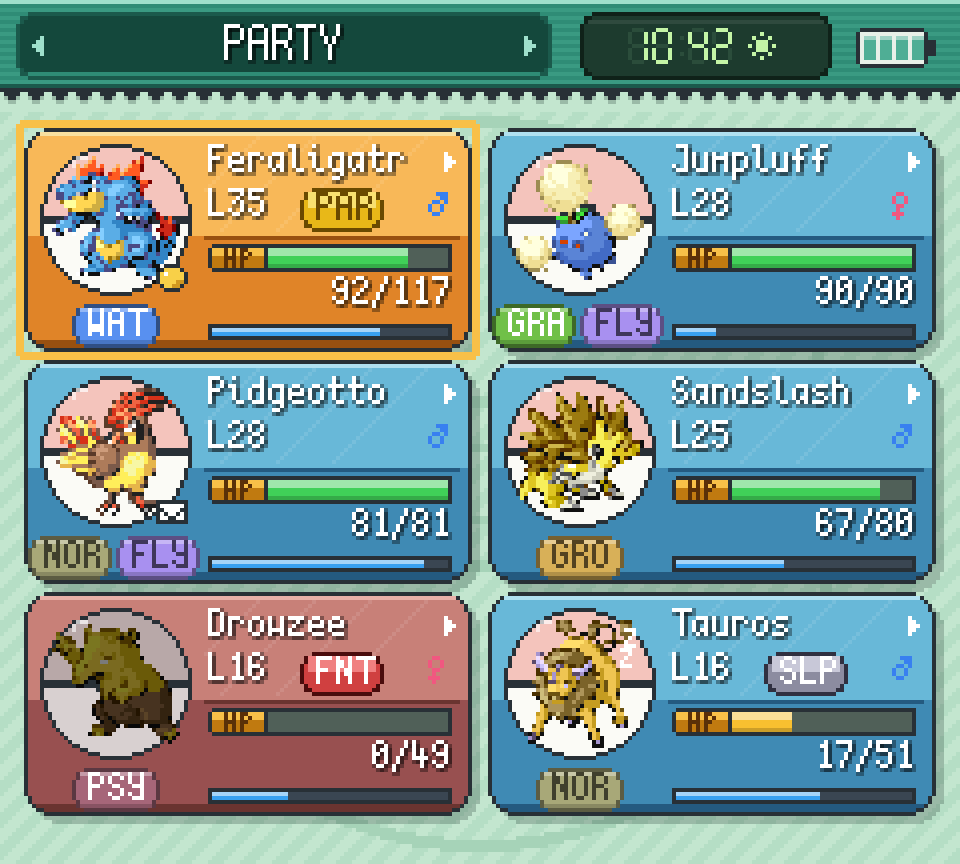

## Progress at your pace

Stamps share their checklist data with Explorer, including supported NPC item
gifts, Pokémon gifts, eggs, trades and prize offers. Explorer covers a location's
associated buildings as well as its outdoor map.

Gold means the area's required goals are complete **and you have visited it**.
Caught-species evidence comes from your save's Pokédex, so a Pokémon obtained
elsewhere can count. Missable encounters and event-only rewards are bonuses;
exclusive choices do not require obtaining both alternatives. Repeatable or
untrackable objectives do not become impossible permanent requirements.

Choose what Gear reveals under **Options → Discovery**:

| Preset | What you see |
| --- | --- |
| **Vanilla** | Strict original-game information. No live area map, encounter guide, extra battle hints, completion totals or hidden partner values. Touch controls, caught Dex entries and your notes remain available. |
| **Guide** | Help for visited places, wild encounters, Dex research and battles. Hidden items still need a scan or collection; unvisited places, future tasks and hidden partner values stay concealed. |
| **Everything** | All information, including hidden items, unvisited locations, future tasks, genes and egg contents. This does not unlock anything in the game. |
| **Custom** | Start from your current preset and choose individual information switches in Exploration, Pokédex, Battle, Partner Data and Stamps. Each switch has an explanation and applies across apps, widgets and battle views. |

Native menus also gain matching touch pages for shops, PC storage and item
storage, dialogue choices, naming, move learning, PP recovery, saving and game
options. Gen 2 Pokégear and the Gen 3 PokéNav menu have companion controls.

Discovery includes separate switches for effectiveness hints, extra move data
and estimated catch odds. Battle layout and caught markers stay under Battle.

  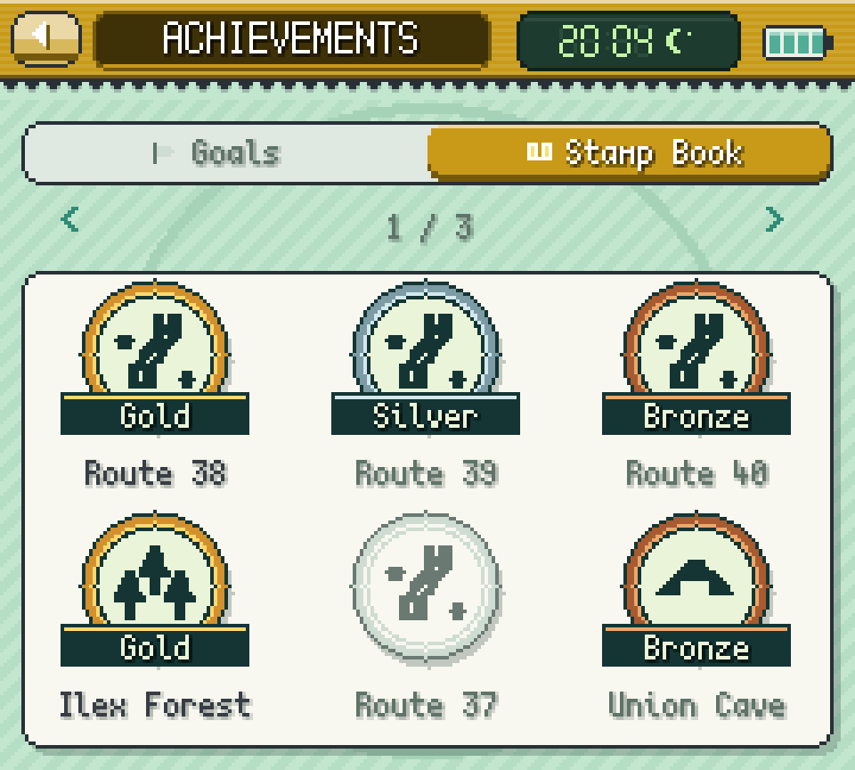
  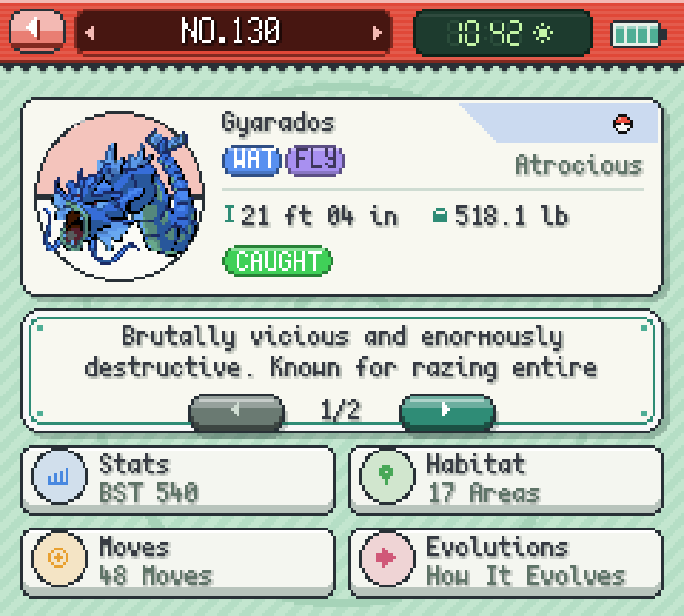

## Battles, your way

Outside battles, the original game screen stays intact. During battles, choose
how much of the interface moves into Gear:

| Mode | Game screen | Gear screen |
| --- | --- | --- |
| **Companion** | Original battle, HP, text and menus | You/VS/Foe or Wild strip; DS-style commands and touch submenus, dimmed during battle text with a Continue arrow when waiting; D-pad input stays with the game |
| **Info** | Original battle and menus | Opponent information; select either opponent in a double battle |
| **Gear** | Battle scene and HP bars | Battle menus, move choices, party, Bag and text, with D-pad focus below |
| **Full Gear** | Battle scene | Gear controls plus HP bars, including all four battlers in doubles |

Friendly and opposing targets have explicit labels. Empty PP and unavailable
moves are marked, and touch feedback only plays when a control can act.
Specialized, tutorial and native online flows retain the original controls
when Gear cannot safely take ownership.

  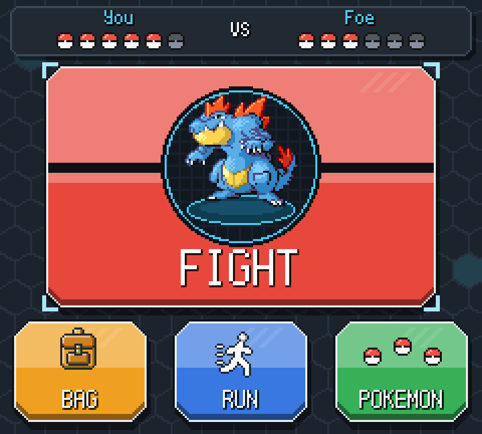
  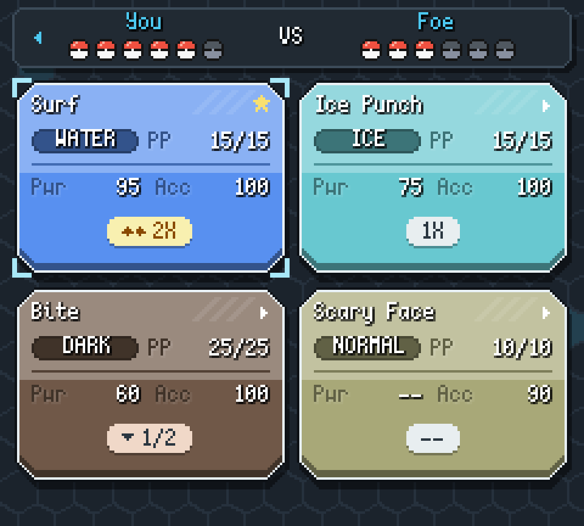

## Get started

1. Install the [latest official Gen1Recomp](https://github.com/bryanthaboi/gen1recomp/releases/latest)
   and import your own supported ROM.
2. Install **Kanto Gear** from the [Mod Index](https://bryanthaboi.github.io/gen1recomp-mod-index/),
   or import the ZIP from the [latest release](https://github.com/AverageConsumer/kanto-gear/releases/latest).
3. Enable the mod, start your game and open Gear's **Options** to choose your layout,
   theme, language and discovery level.

The same ZIP works on Android, Windows and Linux. It includes no ROM or save.
Use the current Recomp release for host fixes and secondary-screen input support.

| Games | Minimum Recomp version |
| --- | --- |
| Red, Blue, Yellow, Gold, Silver, Crystal, FireRed, LeafGreen | 0.3.20 |
| Emerald (US 1.0) | 0.3.33 |
| Ruby and Sapphire (US/Europe) | 0.3.74 |

All Gen 3 games welcome broader playthrough testing and feedback. Some specialized
contest, Frontier and other native screens remain on the game screen.

### One screen or two

| Layout | Use it for |
| --- | --- |
| **Fullscreen Swap** | Switching between the game and Gear on a single screen |
| **Combined** | Both views in one window: stacked, side by side or as a corner overlay |
| **Separate** | Dual-screen handhelds, independent desktop windows or multiple monitors |
| **Phone / Browser** | Gear and optional touch controller buttons on a phone over your local Wi-Fi |

**Auto Battle Screen** can switch to Gear for battle choices and back to the game
for text and animations on single-screen layouts. **Performance** keeps maps smooth
while disabling UI transitions; **Quality** allows optional interface animations.
Both preserve map detail.

### Gear on your phone

**Phone / Browser** is an optional, experimental display mode. Keep your phone
and game device on the same trusted Wi-Fi, choose the mode in Gear's Options,
and scan the QR code. Tap **Connect**; the QR supplies the one-time credential,
so no PIN is needed. You can also open the shown address and enter its code.

The browser can show Gear alone or add game controls. Choose a matching theme,
use a left-handed or one-hand preset, or arrange and resize the controls yourself.
Portrait and landscape layouts are separate. **Remember settings** saves these
preferences only in that browser; it never saves pairing credentials.

To return to a local display without your phone, open Recomp's
**Mods → Kanto Gear → Options → Display Mode** and choose another mode.

This uses a local, **unencrypted** connection, with no account or external service.
Use a private network you trust. Visible Gear content, including open notes, is
sent to the paired browser. Streaming smoothness depends on the devices, browser
and Wi-Fi; feedback is welcome. Use the latest official Recomp and allow the
mod's Network and Compute permissions. Do not expose its port to the internet.
One browser can pair at a time; credentials expire after five minutes and are
single-use. Disconnecting or changing display mode releases phone controls.
If the game device's Wi-Fi address changes, Gear updates the pairing address
and QR code automatically. Reconnect using the new code; no game restart is needed.
The phone stream is capped at 30 FPS to reduce device load; game and controller
input keep their normal update rate.
If the shown address belongs to a VPN, use the game device's private Wi-Fi
IPv4 address with port 8765.

### Languages and online

English, German, Spanish (Spain), French, Japanese and Italian are available under
**Options → Appearance → Language**. Some newer labels fall back to English.
Gear translates its own interface; game names and dialogue come from the game
or a separate translation mod.

The Italian translation is AI-generated, with terminology checked against
official Italian Pokemon sources. Corrections from Italian-speaking players
are welcome: [open an issue](https://github.com/AverageConsumer/kanto-gear/issues)
with the current text, your suggested wording and, if possible, a screenshot.

Silph Connect is a **presence browser and proof of concept**. Friends, chat and
live invitations to battles or trades are not available in this release; supported
access must first be enabled by Gen1Recomp. Its widget shows the visible player
count and a few names. Existing native arena restrictions still apply.

Notes are stored separately for each playthrough. Drawing needs continuous pointer
input from Recomp; if the host reports that it is missing, text and checklists
remain available.

  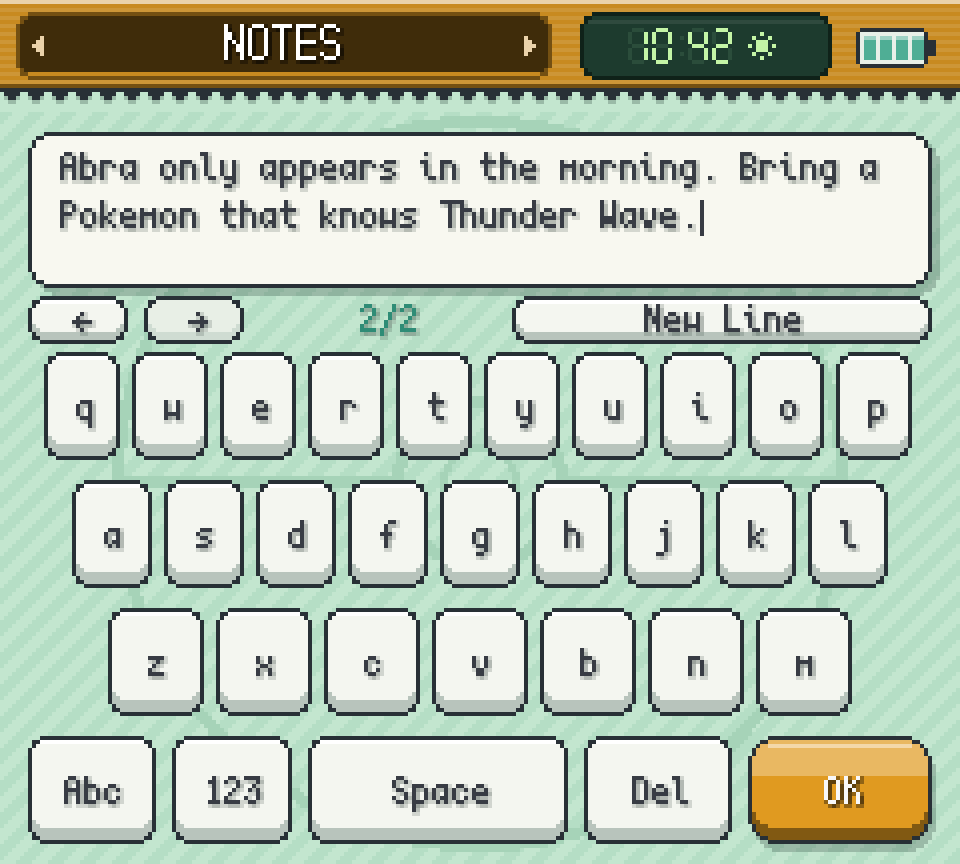
  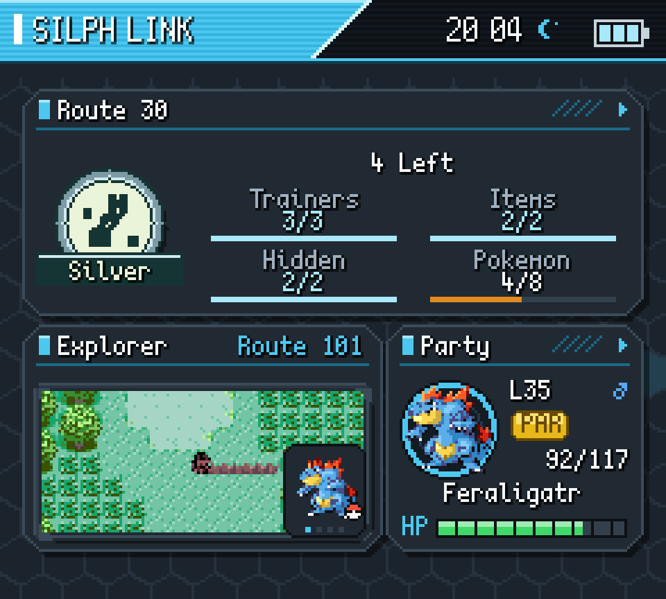

*Images are rendered previews of the current interface with illustrative game data.
Artwork and available information vary by edition and settings.*

## Feedback

[Open an issue](https://github.com/AverageConsumer/kanto-gear/issues) with your game,
device, Recomp and Gear versions, display and battle modes, other active mods,
and steps to reproduce the problem. Screenshots and logs are welcome.

[Release notes](https://github.com/AverageConsumer/kanto-gear/releases)
· [Translation contributions](DEVELOPMENT.md#translations)
· [Font credits](mod/kanto_gear/ui/fonts/FONT_CREDITS.txt)

## Credits

Kanto Gear is built on [Gen1Recomp](https://github.com/bryanthaboi/gen1recomp)
and released under the [MIT License](LICENSE). Spanish was contributed by
**Desierto La Espada**, French by **Blastheaven2** and Japanese by **Theeohn**.
Special thanks to [@Rocky5150](https://github.com/Rocky5150) for extensive device testing.

Font credits:

- **Fusion Pixel** and **Ark Pixel** by **TakWolf**.
- **Misaki** by **Num Kadoma**, **Miseki Bitmap** by **Mark Li**,
  **Boutique Bitmap 7x7/9x9** by **Cen-cyun Liu / Luke Liu**, and
  **Galmuri** by **Lee Minseo (quiple)** contribute to the bundled Fusion fonts.
- The HGSS image fonts use **BobsGame nD** by **Robert Matthew Pelloni** and
  **scientifica** by **Akshay Oppiliappan**.

See [font credits and license locations](mod/kanto_gear/ui/fonts/FONT_CREDITS.txt).
The downloadable ZIP includes these credits and the complete font license
notices. Font assets retain their respective licenses.

The UI icons and item props are original designs drawn by Kanto Gear's UI code. See [asset notes](mod/kanto_gear/ASSET_CREDITS.txt).
Local QR generation uses **luaqrcode** by **Patrick Gundlach and contributors**
under BSD-3-Clause; its full notice is included in the ZIP.

Pokémon and related names are trademarks of their respective owners. This fan
project is not affiliated with Nintendo, Game Freak, The Pokémon Company or
Gen1Recomp.

## Working on Kanto Gear

See the [development guide](DEVELOPMENT.md) for the project map, integration
contracts, translations, tests and package builds. Changes and validation
results are recorded in the [release notes](https://github.com/AverageConsumer/kanto-gear/releases).
